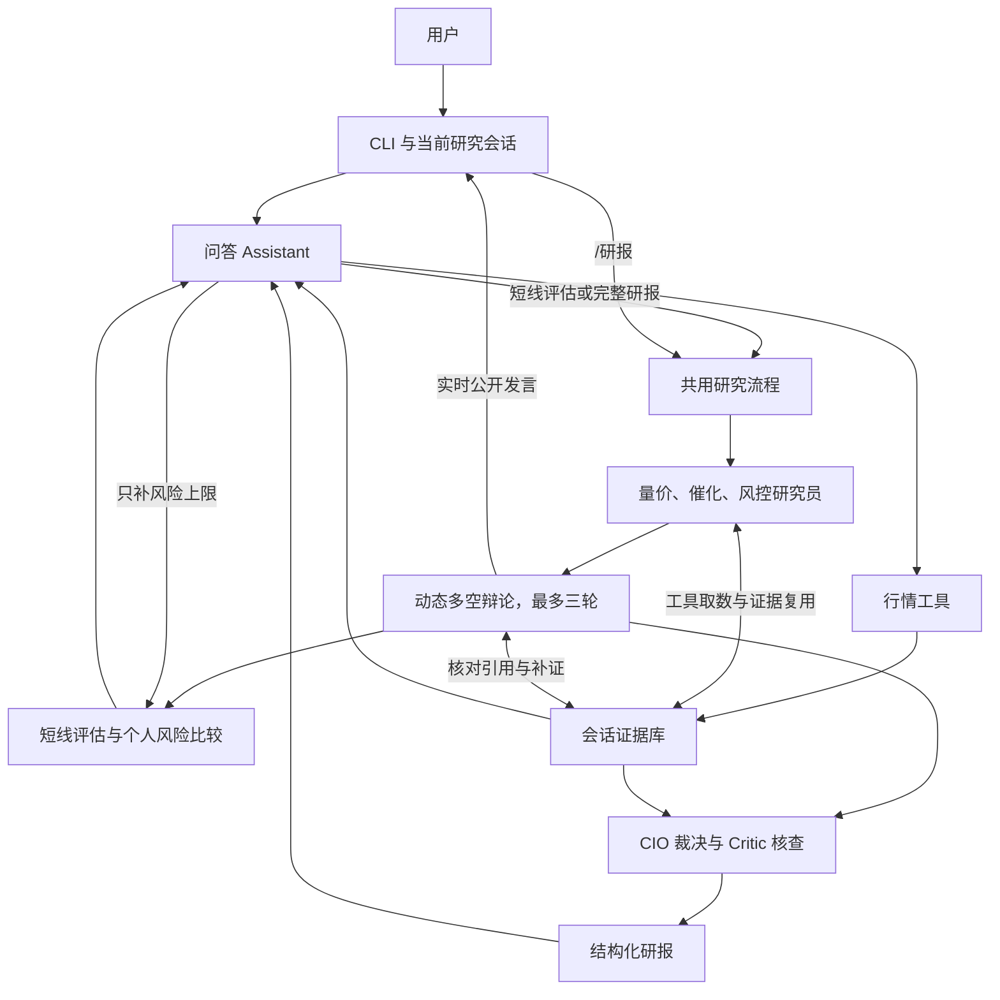

# MarketOracle 后端组件与协作说明

MarketOracle 的终端会话绑定一只股票和一个研究基准日。用户可以直接查询行情，也可以发起短线入场评估或完整研报。两类研究共用三路调研和动态辩论流程。会话保留证据和发言原文，供后续追问。

## 入口与整体流程



- **终端入口。** `cli.py` 解析股票代码、基准日和模拟数据开关，再进入问答循环。`/专业` 和 `/小白` 切换措辞与详略，默认小白模式。`/研报 [关注点]` 直接启动深度研究，小白模式显示摘要，专业模式显示完整 Markdown 报告。[命令行入口](../backend/cli.py)
- **研究会话。** `ResearchSession` 持有股票、基准日和证据库。助手分别保留最新研报、短线评估及各自实录，也保留最近一次未完成的交锋。退出后重新启动会创建新会话。[会话定义](../backend/session.py) · [助手实现](../backend/agents/assistant.py)

## Agents 的分工

| 角色或组件 | 负责什么 | 可以调用什么 |
| --- | --- | --- |
| [问答助手](../backend/agents/assistant.py) | 结合当前问题、会话证据和已有实录回答。模型通过 Function Calling 查询行情、发起研究或更新短线风险上限。小白和专业模式共用同一个 Agent 实例。 | 行情工具、完整研报工具、短线评估工具 |
| [量价研究员](../backend/agents/research_team.py) | 研究走势、均线和量能。完整研报流程会把当前标的和日期的已有行情证据交给它，资料不足时再补查。 | 行情工具 |
| [催化研究员](../backend/agents/research_team.py) | 提炼近期可能影响股票的公司、行业或政策消息，关注消息的时间和证据出处。 | 新闻工具 |
| [风控研究员](../backend/agents/research_team.py) | 排查减持、问询、诉讼等风险线索，并说明资料的覆盖范围。 | 风险工具 |
| [多头与空头辩手](../backend/agents/debate_arena.py) | 读取底稿并补证，之后各自逐段输出公开发言。首轮结束后根据重要未决反驳、可执行动作和剩余时间决定是否续辩。程序记录原话、引用检查、实际轮数和停止原因。 | 行情、新闻和风险工具 |
| [CIO 裁决 Agent](../backend/agents/judge_agent.py) | 根据证据与辩论起草报告，输出评级、置信度、共识、分歧、风险和观察条件。 | 读取证据库和辩论实录 |
| [Reflection Critic](../backend/agents/judge_agent.py) | 核查初稿中的数字、引用和风险说明。程序同时检查部分规则，初稿有问题时可触发一次修订。 | 读取初稿与证据库 |

`ResearchTeam.run_all()` 按量价、催化、风控的顺序生成 `ResearchBriefs`。`research_debate()` 将底稿、研究目标和用户关注点交给辩论场。完整研报由 `conduct_research()` 接续 CIO 裁决与反思核查。短线评估则把实录交给 `assess_entry()`，提炼入场理由、反驳和失效条件。[研究编排](../backend/agents/run_full_pipeline.py) · [短线评估](../backend/agents/entry_assessment.py)

## 实时辩论与动态停辩

1. **先补证，再公开发言。** 每位辩手准备材料时可调用取数工具，随后通过模型的文本流接口生成公开正文。`DebateEvent` 将发言开始、正文增量、结束或中断传给终端。终端即时刷新，每段正文也追加到同一条发言记录。发言结束后核对引用编号，标出待核查的编号。[辩论流程](../backend/agents/debate_arena.py) · [事件定义](../backend/agents/debate_stream.py) · [终端渲染](../backend/cli.py)
2. **一整轮后决定是否继续。** 多头与空头都完成才计一轮。每轮结束，模型独立判断是否有待回应的反驳、它可能改变哪项判断，以及下一轮能采取什么动作。三项齐全且时间允许时进入下一轮，带着原始关注点核实该争点。短线评估和完整研报最多试行三轮，独立教学演示使用固定两轮。[动态与固定辩论](../backend/agents/debate_arena.py) · [教学演示](../backend/agents/run_step2_demo.py)
3. **到期时保留实录。** `ResearchRun` 默认给整次研究 175 秒，调研和辩论阶段预留 35 秒给裁决，问答工具外层的超时配置为 180 秒。中断时保留已显示的正文，未完成发言不计入完整轮数。尚未完成一轮时，完整研报以未完成状态返回。裁决失败时仍可追问本次实录。研究结束后，迟到的正文、结果和取数写入会受到当前运行状态检查。[时间预算](../backend/agents/debate_stream.py) · [中断处理](../backend/agents/run_full_pipeline.py) · [证据写入](../backend/tools/hello_adapter.py)

## 短线条件与风险重算

拟入场价优先使用用户给出的假设。缺少假设时，从当前股票和基准日的行情证据中选取最近有效收盘价，显示交易日、来源和证据编号。缺少价格时，评估仍可呈现有依据的定性条件。用户可以先听辩论，再补相对入场价的可承受跌幅。[价格与条件处理](../backend/agents/entry_assessment.py)

程序用拟入场价乘以（1 − 可承受跌幅）计算风险参考价。评估只有在双方认可失效位、且引用了实录中已登记的证据时才将该失效位纳入价格比较。有争议的失效位和非价格条件保留在文字说明里。用户只补风险上限时，助手更新最近一次短线评估，复用其证据和实录完成重算。[风险比较](../backend/agents/entry_assessment.py) · [会话追问](../backend/agents/assistant.py)

## Tools 的分工

| 工具名 | 取数与处理 | 产物 |
| --- | --- | --- |
| `get_market_technical` | 用 AkShare 取截至基准日的前复权日线，默认回溯 180 个自然日。优先东方财富，异常或无有效日线时切换腾讯。Python 计算涨跌幅、均线、回撤和量比，记录实际交易日、样本数、量比窗口起点和成交量单位。 | `EV_TECH_...` 行情证据。[实现](../backend/tools/market_data.py) |
| `search_news_catalyst` | 用 AkShare 东方财富个股资讯接口取数。默认筛选基准日前 14 天内的新闻，在单次调用中按标题去重，并标注缺少日期的条目。 | `EV_NEWS_...` 新闻证据。[实现](../backend/tools/news_catalyst.py) |
| `check_risk_and_notices` | 复用个股资讯接口，默认按 30 天窗口筛查减持、质押、解禁、问询、诉讼等关键词。检索结果反映这批资讯的覆盖范围，正式公告需看原始披露。 | `EV_RISK_...` 风险线索。[实现](../backend/tools/risk_notice.py) |
| `run_stock_deep_research` | 由 `DeepResearchTool` 暴露给问答助手，接收可选关注点，使用会话固定的标的和基准日编排完整研报。 | 研报 Markdown 返回给模型，结构化报告保存在助手里。[实现](../backend/agents/assistant.py) |
| `assess_stock_entry` | 围绕用户的短线入场假设组织多空辩论。用户稍后仅补充相对入场价的风险上限时，沿用实录和证据重新计算。 | 多空理由、失效条件、个人风险比较和重评时机。[实现](../backend/agents/entry_assessment.py) |

### 注册、执行与证据复用

1. **注册工具。** `build_role_registries()` 给各角色分配可见工具。模型收到注册工具的名称、描述和参数格式，使用原生 Function Calling 发出结构化请求。问答助手与量价研究员使用同一个行情工具实例，辩手也能复用这个实例。[工具注册](../backend/tools/hello_adapter.py) · [助手注册](../backend/agents/assistant.py)
2. **执行工具。** `HelloEvidenceTool` 接收参数，校验会话绑定的股票与日期，随后调用实际的 Python 工具。会话内同一工具、标的、基准日和回溯参数的成功结果可以复用原证据编号。工具返回的错误证据包也会入库，后续可重试。[工具适配器](../backend/tools/hello_adapter.py)
3. **收集证据。** `BaseEvidenceTool` 负责生成编号、处理基准日并封装结果。`EvidenceStore` 按编号索引证据条目，也保留各次调用的证据包。Agent 从证据中取事实并组织语言，行情指标由工具计算。[工具基类](../backend/tools/base_evidence_tool.py) · [证据库](../backend/tools/hello_adapter.py)

## 数据结构与输出

| 结构 | 保存的内容 |
| --- | --- |
| [`EvidenceItem`](../backend/schemas/evidence.py) | 一条证据的编号、标的、标题、摘要、来源、日期、结构化数据和降级说明。 |
| [`EvidenceBundle`](../backend/schemas/evidence.py) | 一次工具调用的状态、基准日、证据列表和错误信息。状态包括 `ok`、`partial`、`error`。 |
| [`ResearchBriefs`](../backend/agents/research_team.py) | 量价、催化和风控三路研究底稿。 |
| [`DebateTranscript`](../backend/agents/debate_arena.py) | 发言原文、发言是否完成、引用检查、实际完成轮数、停止原因和未决争点。旧记录缺少停止原因时显示“未记录”，展示轮数按完整发言重新核对。 |
| [`EntryAssessment`](../backend/agents/entry_assessment.py) | 入场假设与来源、个人风险上限、失效条件、多空实录和重评时机。 |
| [`FinalResearchReport`](../backend/schemas/report.py) | 裁决结果、评级、置信度、综合摘要、多空共识和分歧、交易与风控预案、风险提示、引用和核查状态。支持渲染成 Markdown。 |

核查状态主要反映初稿检查结果。当前实现遇到无法解析的 Critic 输出时会标记“审计格式解析跳过”并继续。需要修订时，修订稿经过结构校验后输出。[报告核查](../backend/agents/judge_agent.py)

独立入口 `run_stock_deep_research()` 默认在 `logs/runs/` 写入含 `report`、`debate` 和 `evidences` 的 JSON。未完成的研究写入带 `_incomplete` 后缀的文件，报告字段为 `null`。[研报落盘](../backend/agents/run_full_pipeline.py)

## 本地体验与测试

模拟模式使用内置的行情、新闻、风险与公告样本，不读取真实公告库或访问向量服务。交互问答与研报仍调用已配置的模型；离线回归会替换模型。模型配置读取 `MARKETORACLE_MODEL`、`MARKETORACLE_MODEL_URL` 和 `MARKETORACLE_MODEL_KEY`。[模拟数据](../backend/agents/run_step2_demo.py) · [模型配置入口](../backend/cli.py)

## 五粮液财报与公告试点

Web 中新建 `000858.SZ` 会话并取消模拟，或运行 `python -X utf8 -m backend.cli --symbol 000858.SZ --as-of 2026-05-01`。试问“2025 年第三季度单季营业收入是多少？”，再问“那前三季度累计呢？”或“原文第几页？”。基准日决定能看到哪个版本，要回看另一个日期，请新建会话。其他标的不在本地库覆盖范围内，不等于公司未披露。

| 环境变量 | 未设置时 | 设为 `0` |
| --- | --- | --- |
| `MARKETORACLE_RAG_CHAT_METRIC` | 开启聊天精确查数，不需要向量服务 | 关闭聊天查数 |
| `MARKETORACLE_RAG_CHAT_SEARCH` | 已配置 `DASHSCOPE_API_KEY` 和 `MARKETORACLE_EMBEDDING_URL` 时开启，模拟模式也开启 | 关闭聊天查公告正文 |
| `MARKETORACLE_RAG_RESEARCH` | 模拟模式开启；真实模式需设为 `1` 才在深研试用 | 关闭深研 RAG 工具 |

修改开关后重启入口或新建会话。真实公告查询只读取既有验收文件及就绪集合；换库后重启进程重新加载索引快照。向量故障只影响正文检索，不影响查数和行情。将 `backend.tools.announcement_rag` 日志级别设为 `INFO` 可观察工具、基准日、快照版本、命中数、耗时及失败类型，不记录查询全文和密钥。

```powershell
conda activate marketoracle
python -X utf8 -m backend.cli --symbol 300750.SZ --as-of 2026-11-20 --mock-data
python -X utf8 -B -m unittest discover -s backend/tests -v
```

进入终端后，可以先输入“假设 100 元入场，先听短线多空理由”，再输入“最多接受从入场价下跌 3%，其余条件不变”。前一问可以看到公开正文逐段出现，后一问应沿用本次评估给出 97 元风险参考价。用 `/研报 成交量和减持` 可体验完整研报的实时辩论。

工具测试覆盖主备行情切换、时间窗口与异常。问答和辩论测试使用模型替身，验证证据复用、正文先于发言结束显示、动态轮数、风险重算及迟到发言屏蔽。[工具测试](../backend/tests/test_tools.py) · [问答测试](../backend/tests/test_stock_chat.py) · [辩论测试](../backend/tests/test_live_debate.py)
